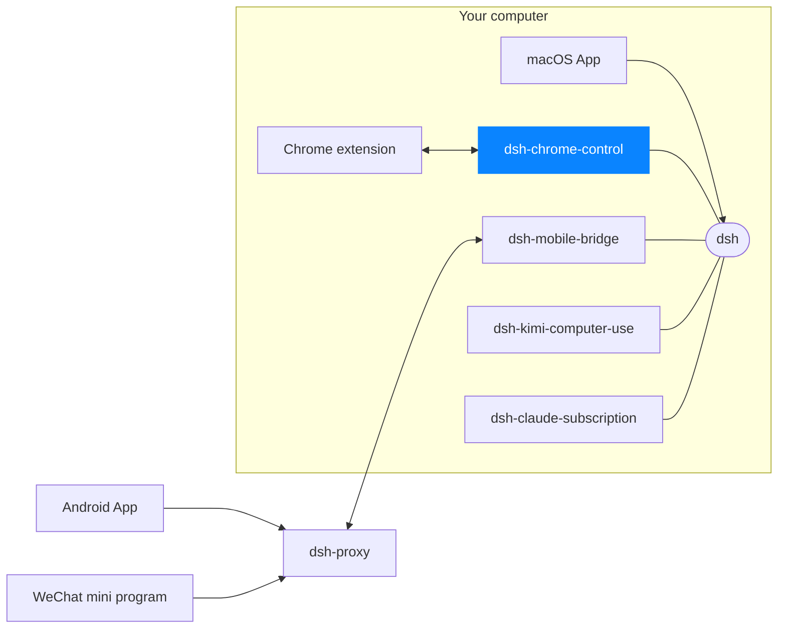

# dsh-chrome

A DeepSeek Harness bundle that gives the agent control of the user's **real
Chrome** — their profile, their logins, their open tabs — as `mcp__chrome__*`
tools. The Chrome bridge runs in a small standalone Rust process,
`chrome-daemon`, which this plugin starts and adopts.

> **Requires the Chrome extension.** This plugin is only the server half. It
> must be used together with the **Deepseek Harness APP** Chrome extension from
> the Chrome Web Store:
> <https://chromewebstore.google.com/detail/deepseek-harness-app/kgjjicancjnedmappjhefngdjaommpop>
>
> Without the extension installed and connected, every `mcp__chrome__*` tool
> reports that no Chrome extension is attached.

## How it fits together

```
agent ──▶ dsh web :3080 ── in-box mcp-client (Node) ──HTTP──┐
            └─ GET /chrome/status  (proxied to the daemon)  │
                                                            ▼
          chrome-daemon  127.0.0.1:37086  (Rust, detached, outlives dsh web)
            ├─ POST /chrome/mcp       MCP Streamable HTTP endpoint   ← dsh web only
            ├─ GET  /chrome/status    liveness / build probe         ← dsh web only
            ├─ POST /chrome/shutdown  retire a stale build           ← dsh web only
            ├─ GET  /chrome/ws  ◀──WebSocket── extension ──CDP──▶ page
            └─ POST /host/*           settings-UI host operations    ← extension only
```

The bundle's patch contributes three rows:

| Row | Job |
|---|---|
| `chrome-server` | Starts `chrome-daemon` on `127.0.0.1:37086` (or reuses a running one with the same build hash, retiring a stale one), proxies `/chrome/status` on the harness's own `webServer`, and loads the in-box `@deepseek-ai/dsh-mcp-client` bridge against the daemon's `/chrome/mcp`. The bridge publishes the catalog as `mcp__chrome__*`. |
| `chrome-skills` | Registers the bundled skill that teaches the agent how to drive those tools. |
| `chrome-web-search` | Registers the `chrome-browser` search provider for the built-in `web_search` tool. Off until selected; see [Web search through Chrome](#web-search-through-chrome). |

## Install

```bash
dsh plugin --profile web add dsh-chrome-control     # or a link: dependency for local dev
```

Then **install the browser extension yourself** from the
[Chrome Web Store — Deepseek Harness APP](https://chromewebstore.google.com/detail/deepseek-harness-app/kgjjicancjnedmappjhefngdjaommpop)
(click *Add to Chrome*). Installing an extension is a decision only the
browser's owner can make, so nothing does it for you. No address needs
configuring: the extension's bridge socket connects straight to the daemon at
`ws://127.0.0.1:37086/chrome/ws`, not to `dsh web`. Its *DSH server* setting
(default `http://127.0.0.1:3080`) is the `dsh web` URL the side panel and the
Native Messaging autostart use; it does not move the bridge socket. Until the
extension is connected, every tool returns a message saying exactly that.

## Native Messaging host (installed on every boot)

The store extension cannot start processes, so it relies on a Native Messaging
host, `com.dsh.chrome`, for exactly two things: **starting `dsh web`** when it
is down, and **signing the login cookie** with the browser-session secret in
`$DSH_HOME/.credentials.yaml`. This plugin registers it every time dsh boots —
there is no separate installer to run:

```
$DSH_HOME/native-host/dsh-native-host.mjs   the host (copied from native-host/ in this package)
$DSH_HOME/native-host/dsh-native-host       launcher Chrome executes; absolute node, forwards argv
$DSH_HOME/native-host/config.json           node + entry of the dsh that booted, used to start it again
<browser>/NativeMessagingHosts/com.dsh.chrome.json   for each Chromium-family browser present
```

`<browser>` is `~/Library/Application Support/<vendor>` on macOS and
`$XDG_CONFIG_HOME/<browser>` (default `~/.config`) on **Linux**: `google-chrome`
(+ `-beta`, `-unstable`), `chromium`, `microsoft-edge` (+ `-beta`, `-dev`),
`BraveSoftware/Brave-Browser`, `vivaldi` (+ `-snapshot`). Snap/Flatpak browsers
are confined and cannot execute a host outside their sandbox, so they are not
targeted. The launcher is POSIX `sh` (no bash assumption), and tries the
recorded node, then Homebrew/Linuxbrew, `/usr/local`, `/usr/bin`, Volta, snap,
and finally `node` on `PATH`. On Linux `filePaths` reads `text/uri-list` from the
clipboard with `wl-paste` (Wayland, package `wl-clipboard`) or `xclip` (X11);
without either it answers `clipboard-tool-missing`, and like Windows there is no
drag pasteboard (`unsupported-board`).

On **Windows 10+** Chrome never looks for host manifests in a directory — it
only reads the registry, which is why a manifest file alone reports "Specified
native messaging host not found". The layout there is:

```
%DSH_HOME%\native-host\dsh-native-host.mjs   the host
%DSH_HOME%\native-host\dsh-native-host.cmd   launcher (Chrome runs it through cmd.exe); forwards %*
%DSH_HOME%\native-host\config.json           as above
%DSH_HOME%\native-host\com.dsh.chrome.json   the manifest, pointing at the .cmd launcher
HKCU\Software\Google\Chrome\NativeMessagingHosts\com.dsh.chrome          (Default) = that manifest; always
HKCU\Software\{Chromium | Microsoft\Edge | BraveSoftware\Brave-Browser}\…  same, when that browser's User Data exists
```

The keys live under HKCU, so no elevation is needed; they are written with the
system `reg.exe` and only when their value differs. (A machine policy that sets
`NativeMessagingUserLevelHosts` to false makes Chrome ignore HKCU hosts.) The
launcher finds the host and `DSH_HOME` from its own directory (`%~dp0`), so a
non-ASCII profile path survives cmd's OEM code page; node is tried as recorded,
then `%ProgramFiles%\nodejs\node.exe`, then `PATH`. `dsh web` is started
without a console window. `filePaths` reads the Windows clipboard (copy/paste of
folders); Windows keeps no drag pasteboard, so `board: "drag"` answers
`unsupported-board`.

Writes are compare-then-rename, so an unchanged boot touches nothing; failures
are logged and never stop the plugin. Supported on macOS, Linux and Windows 10+.

Only `chrome-extension://kgjjicancjnedmappjhefngdjaommpop` may call it, checked
twice: Chrome enforces the manifest's `allowed_origins`, and the host itself
compares the caller origin Chrome passes as its first argument, refusing
anything else before it reads a message. It will also only start dsh on a
loopback host.

## Behaviour worth knowing

- **Fixed daemon port.** The daemon always listens on `127.0.0.1:37086`,
  which is also the extension's default bridge address
  (`ws://127.0.0.1:37086/chrome/ws`). It is detached, so it survives `dsh web`
  restarts; stop it with `kill -TERM <pid>`.
- **Daemon log: `$DSH_HOME/logs/chrome-daemon.log`.** The daemon's stdout and
  stderr go to this file (appended; rotated to `.1` past 5 MiB at the next
  spawn), never to pipes into `dsh web`: a pipe dies with the `dsh web` that
  spawned it, while the daemon lives on. The daemon itself also treats a dead
  log destination as harmless. It once was not — a failed log write panicked
  the extension's socket task, after which the extension showed as
  disconnected and every tool call timed out.
- **Startup order does not matter.** The bridge is loaded with
  `failOnStartupError: false` and its own reconnect policy; the extension may
  attach at any time.
- **This plugin needs the `webServer` service** (the Web composition). In a
  profile without it, the row stays pending and nothing breaks.
- **Response size guards.** Text tool results are capped at 256 KiB (with a
  trailing `[truncated]` marker) and top-level arrays past 4000 elements are
  sliced; the extension WebSocket frame limit is 8 MiB. These keep a giant
  `snapshot` full outline or `get_text` dump from stalling the shared `dsh web`
  event loop. For very large pages, narrow `snapshot` to a subtree (or pass a
  container ref), or prefer `get_text`.

## Tools

`navigate`, `find_tab`, `list_tabs`, `close_tab`, `close_session`,
`snapshot`, `click`, `fill`, `upload`, `evaluate`, `screenshot`, `save_as_pdf`,
`mouse_click`, `key_type`, `send_keys`, `hover`, `focus`, `select`,
`scroll`, `scroll_into_view`, `find`, `wait`, `wait_for_selector`,
`network`, `network_detail`, `dialog`, `get_text` — each prefixed
`mcp__chrome__`.

`upload` forwards local paths to Chrome. Its selector may be a file input or a visible upload trigger; the extension resolves standard label, ARIA and unique-container relationships without framework-specific selectors.

These are distinct from the harness's built-in `browser_*` tools, which drive a
separate WebKit panel sharing no cookies or logins with Chrome. The bundled
skill tells the agent when to use which.

## Web search through Chrome

The `chrome-web-search` row lets the harness's own `web_search` tool search in Chrome instead of calling a search API. The model sees the same `web_search` tool and result format; only the backend changes. Each query opens a fresh tab in its own `web_search` tab group, reads the organic results (title, destination URL, snippet, leading date as `publishedAt`), and closes the tab. Queries in one call run in parallel tabs.

It is **off by default**: the DSH web service picks one search provider through `web.searchProvider`, and the shipped composition picks DeepSeek. Turn it on by selecting this provider, from the DSH App (Settings → Browser → Web search) or in the profile's `cordis.patch.yml`:

```yaml
- id: web
  config:
    searchProvider: chrome-browser

- id: chrome-web-search
  config:
    engine: google        # google (default) | bing | baidu | sogou | toutiao
```

Both values are live settings: a change applies to the next search without a restart. Removing `searchProvider` returns to the composed default.

| `chrome-web-search` key | Default | Meaning |
|---|---|---|
| `engine` | `google` | Result page to search: Google, Bing, Baidu, Sogou, or Toutiao (头条搜索). |
| `resultWaitMs` | `10000` | How long to wait for the result page to render before reading it. |

Failures reach the model as a failed `web_search` call: `WEB_PROVIDER_ERROR` when the daemon is unreachable, the extension is not attached, or the page cannot be read; `WEB_SEARCH_CAPTCHA` when the engine shows a bot check, in which case the tab stays open so the user can solve it; `WEB_ABORTED` when the call is cancelled or times out. Result reading depends on each engine's page markup (`ENGINE_SPECS` in [src/web-search.ts](src/web-search.ts)); a markup change can return empty results until the selectors are updated. Uninstalling this plugin while `web.searchProvider` still names `chrome-browser` makes every search fail with `WEB_PROVIDER_CONFIGURED_MISSING`; remove the setting too.

## Security

While the extension is connected the agent acts with **your logged-in
sessions**, `upload` may expose explicitly named local files to the page, and `mouse_click`/`key_type` send *trusted* input that pages cannot
distinguish from your own. The extension popup has an **Allow agent control**
toggle that severs this immediately. The daemon binds to the loopback only
and sends no telemetry.

### Who may call the daemon

Every request passes one gate (`daemon/src/request_guard.rs`) before any route
runs, 404s included. It relies only on headers a browser sets and a web page
can neither drop nor forge:

| Check | Rule |
|---|---|
| `Host` | when present, must be `127.0.0.1`, `localhost` or `[::1]` — defeats DNS rebinding, whose requests still carry the attacker's name |
| `/chrome/ws`, `/host/*` | `Origin` must equal `chrome-extension://kgjjicancjnedmappjhefngdjaommpop` **exactly** — refuses pages, every other extension, and a missing `Origin` |
| everything else (`/chrome/mcp`, `/chrome/status`, `/chrome/shutdown`, future routes) | **no `Origin` at all** — the caller is `dsh web`'s Node client; any browser request (fetch, `no-cors`, form post) carries one and is refused |

The extension id is the Chrome Web Store id, defined once in
`daemon/src/host_guard.rs`. The extension repository ships the store's public
key as `key` in `manifest.json`, so an unpacked development build has the same
id; strip `key` when packaging for the store.

Not covered: another local process running as the same user, which can send
any header. That is accepted — such a process can already drive Chrome's
profile, `git` and `pnpm` directly, and a token file would be readable by it
just the same.

## Host operations (`/host/*`)

Alongside the Chrome bridge, the daemon exposes a small REST surface the
extension's settings UI uses for things an extension cannot do itself, because
it cannot start a process:

```
POST /host/capabilities    { }
POST /host/git             { cwd, args[] }
POST /host/plugin          { action, name? }
POST /host/server/version  { }
POST /host/server/restart  { }
POST /host/server/update   { }
POST /host/disable         { }
```

These are **not** MCP and share no codec with `/chrome/mcp`; nothing here goes
near the control WebSocket, since a second connection to `/chrome/ws` makes the
hub fail the extension's in-flight calls and drop it for tens of seconds.

Every route is a POST, including the capability probe, and that is load-bearing
rather than stylistic: Chrome sends **no `Origin` header** on a simple `GET`
from an extension page, so an Origin-only guard cannot authenticate one. An
earlier revision exposed `GET /host/capabilities` and the side panel's own probe
was refused, which made the whole Git tab report "this deployment does not offer
host operations". `POST` with `application/json` is a preflighted request, so
the header is always present. `GET` now answers 405 naming the right method.

A non-zero subprocess exit is returned as HTTP 200 with an `exitCode`, because
the UI needs git's own stderr rather than a generic 500.

### dsh is resolved through pnpm, by shim path

`/host/server/*` runs `$PNPM_HOME/dsh`, never whatever `dsh` is first on
`PATH`, and never the path that shim resolves to. Both rules exist because of
measured failure modes:

- A machine can carry two installs (say an npm-global copy earlier on `PATH`
  plus the pnpm one). Updating with pnpm while launching from `PATH` updates one
  copy and keeps running the other, so the version never changes and the update
  looks like it worked.
- The pnpm shim `exec`s a content-addressed directory whose hash changes on
  every reinstall. A resolved inner path is therefore valid only until the next
  update — exactly when a restart tends to be requested.

When dsh is not a pnpm install, these routes return 400 with
`reason: "dsh-not-installed-via-pnpm"` rather than falling back.

`/host/server/version` reports the version of the `dsh web` actually running,
so an update that has not been restarted into still shows the old version. A
server this daemon restarted reports the `dsh --version` recorded just before
launching it (an in-place install rewrites the package under a running
process); any other is read from the package its command line runs
(`…/@deepseek-ai/dsh/lib/bin.js`, or the one a `dsh` bin link resolves to). Only when no server can be read does it fall
back to `$PNPM_HOME/dsh --version`.

### The guard, and what it does not cover

`/host/*` requires `Origin` to equal the one authorized extension exactly, and
is served only when the daemon is bound to loopback. That stops web pages
(browsers will not let a page forge an extension origin) and other extensions
(compared with `==`, never `starts_with`, which would admit any extension). The
router-wide gate above enforces this first; each `/host/*` handler checks it
again, so dropping the middleware in a refactor cannot open these routes.

It does **not** stop another local process running as the same user: such a
process can set any `Origin`, and loopback TCP exposes no peer pid or uid. This
is an accepted trade-off, on the grounds that the same process can already run
`git` and `pnpm` directly. What limits it instead, and must not be relaxed:

1. subcommand **and option** allowlists (`-c`, `--upload-pack` and friends are
   refused, since they make git run arbitrary programs);
2. registry-only package specs (`file:`, `link:`, `git+`, `github:` refused);
3. the server operations taking no caller-supplied command, pid or package name
   — restart proves the process on the port really is `dsh web` before
   signalling it;
4. `POST /host/disable`, which withdraws the whole surface until restart while
   leaving `/chrome/*` untouched;
5. refusing to serve `/host/*` at all when bound off the loopback.

## Tests

```bash
pnpm run check   # typecheck + build + unit and end-to-end tests
cd daemon && cargo test
```

The end-to-end suite boots a real `webServer` on an ephemeral port, lets the
in-box bridge discover the catalog through `/chrome/mcp`, attaches a fake
extension over the real WebSocket, and completes a whole tool call round trip.

<!-- dsh-family:start -->
## The DSH App family

**DSH App** is a family of clients and plugins built for [DeepSeek Harness](https://github.com/deepseek-ai/deepseek-harness) (`dsh`). Every piece plugs into the **same** dsh on your computer, so sessions, models and plugins are shared everywhere — combine the ones you need. Downloads and docs: **[dshapp.github.io](https://dshapp.github.io/en/)**.



| | Project | What it does | Links |
| --- | --- | --- | --- |
| Clients | **macOS App**<br>`dsh-macapp` | Native SwiftUI client that hosts your local dsh and switches on every extension | [Overview](https://dshapp.github.io/en/products/macos/) · source coming soon |
|  | **Android App**<br>`dsh-androidapp` | DSH in your pocket: approvals, questions and notifications, end-to-end encrypted | [Overview](https://dshapp.github.io/en/products/android/) · source coming soon |
|  | **DSH Remote (WeChat)**<br>`dsh-miniapp` | No install: take over DSH from WeChat on iPhone or Android | [Overview](https://dshapp.github.io/en/products/miniapp/) · source coming soon |
|  | **Chrome extension**<br>`dsh-chrome-extension` | DSH in the browser side panel, and the executing half of browser control | [Overview](https://dshapp.github.io/en/products/chrome/) · source coming soon |
| dsh plugins | **Browser control** ← you are here<br>`dsh-chrome-control` | Hands your signed-in Chrome to the agent as `mcp__chrome__*` tools | [Overview](https://dshapp.github.io/en/products/chrome/) |
|  | **Mobile bridge**<br>`dsh-mobile-bridge` | Serves dsh to paired phones over a Noise tunnel, without opening a port | [Overview](https://dshapp.github.io/en/products/android/) · [Source](https://github.com/dshapp/dsh-mobile-bridge) |
|  | **Computer use**<br>`dsh-kimi-computer-use` | Lets the agent operate Mac apps that have no API, in the background | [Overview](https://dshapp.github.io/en/products/cu/) · [Source](https://github.com/dshapp/dsh-kimi-computer-use) |
|  | **Claude subscription**<br>`dsh-claude-subscription` | Runs Claude models in DSH on your Claude Code subscription, no API key | [Source](https://github.com/dshapp/dsh-claude-subscription) |
| Infrastructure | **Relay**<br>`dsh-proxy` | The only public piece of mobile access: one port, ciphertext only, no state | [Overview](https://dshapp.github.io/en/docs/crypto/) · [Source](https://github.com/dshapp/dsh-proxy) |
|  | **Website**<br>`dshapp.github.io` | Downloads, docs and release notes | [Overview](https://dshapp.github.io/en/) · [Source](https://github.com/dshapp/dshapp.github.io) |
<!-- dsh-family:end -->
